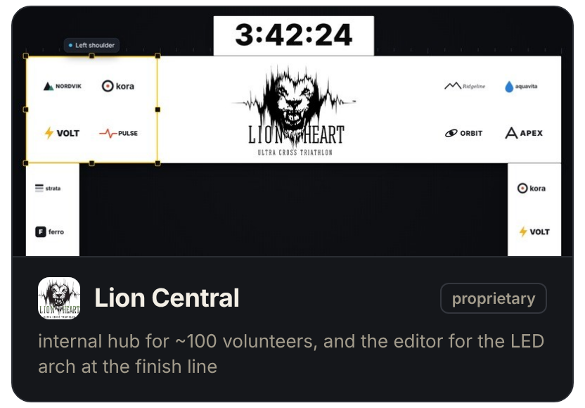
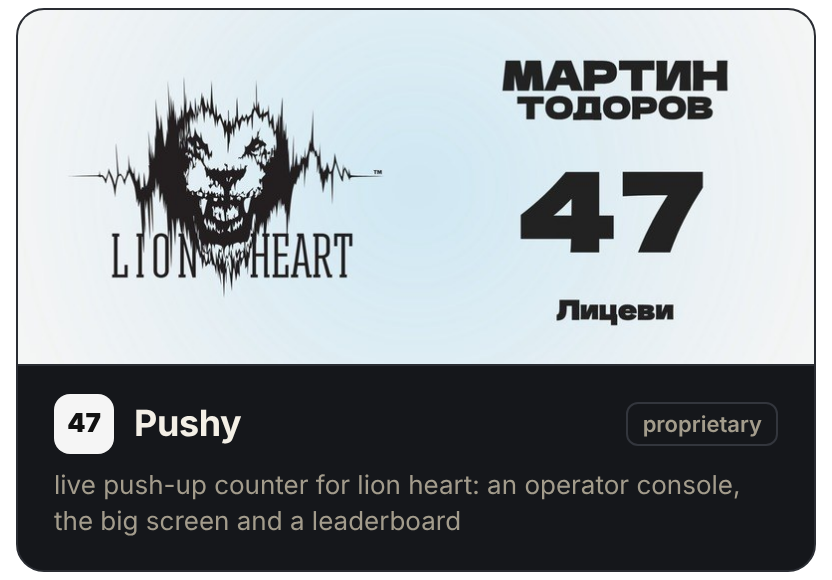
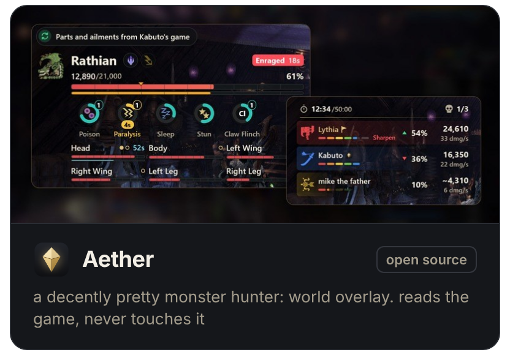
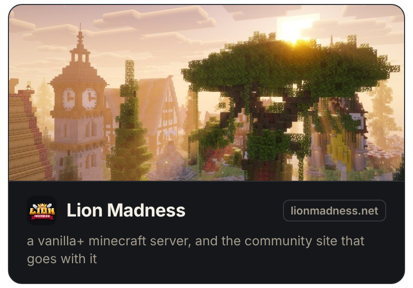

 

i build the things i go looking for and can't find. 
music, design, and one question i can't put down: how could this be better?

 

 
people who ended up here

---

### things i've made

---
