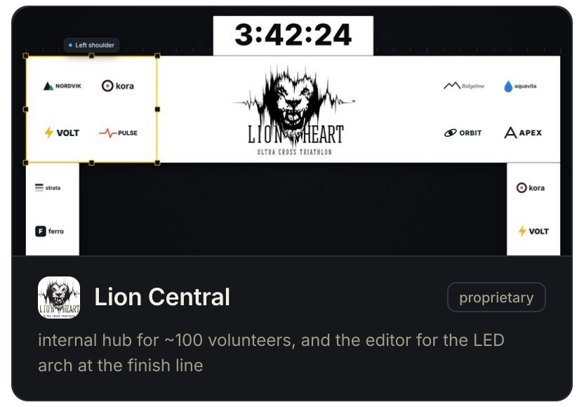
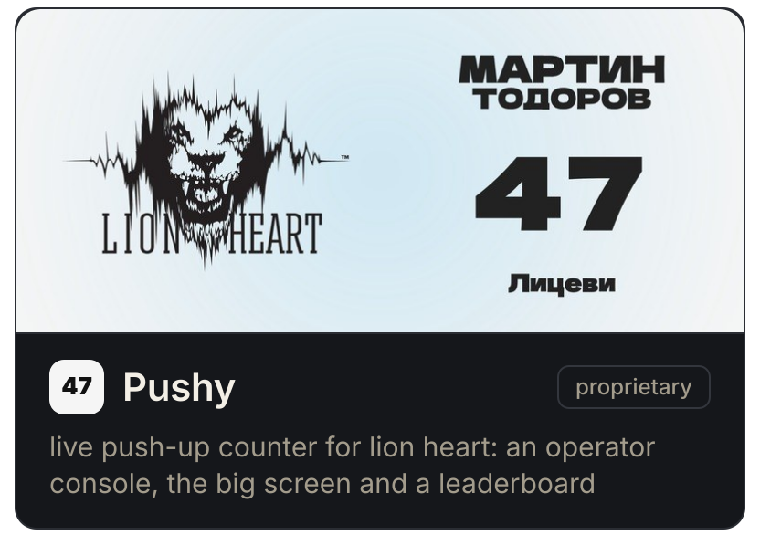
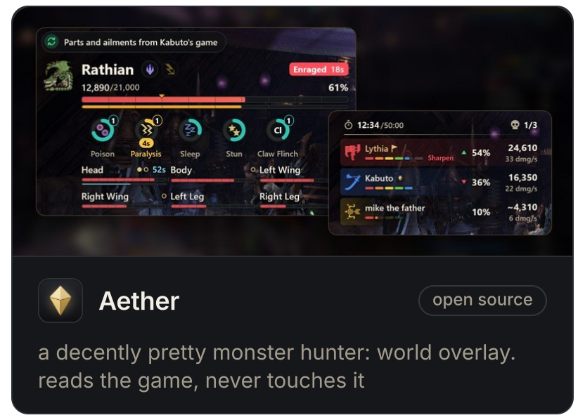
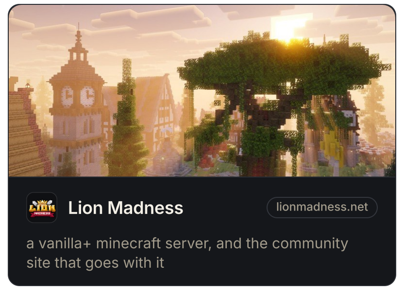

<a href="https://discord.com/users/980888932520722523"><picture><source media="(prefers-color-scheme: dark)" srcset="https://lanyard.cnrad.dev/api/980888932520722523?borderRadius=12px&hideActivity=whenNotUsed&theme=dark&bg=15171b"/><source media="(prefers-color-scheme: light)" srcset="https://lanyard.cnrad.dev/api/980888932520722523?borderRadius=12px&hideActivity=whenNotUsed&theme=light&bg=ffffff"/></picture></a>

<picture><source media="(prefers-color-scheme: dark)" srcset="sofia-dark.svg"/><source media="(prefers-color-scheme: light)" srcset="sofia-light.svg"/></picture>

 

i build the things i go looking for and can't find. 
into music, design, and always stuck on the question of how something could be better

 

 
people who ended up here

---

### things i've made

<a href="https://ultra.lionheart.bg/"><picture><source media="(prefers-color-scheme: dark)" srcset="cards/lioncentral-dark.svg"/><source media="(prefers-color-scheme: light)" srcset="cards/lioncentral-light.svg"/></picture></a><a href="https://ultra.lionheart.bg/"><picture><source media="(prefers-color-scheme: dark)" srcset="cards/pushy-dark.svg"/><source media="(prefers-color-scheme: light)" srcset="cards/pushy-light.svg"/></picture></a><a href="https://github.com/noahwaseaten/Aether"><picture><source media="(prefers-color-scheme: dark)" srcset="cards/aether-dark.svg"/><source media="(prefers-color-scheme: light)" srcset="cards/aether-light.svg"/></picture></a><a href="https://lionmadness.net/"><picture><source media="(prefers-color-scheme: dark)" srcset="cards/lionmadness-dark.svg"/><source media="(prefers-color-scheme: light)" srcset="cards/lionmadness-light.svg"/></picture></a>

---
